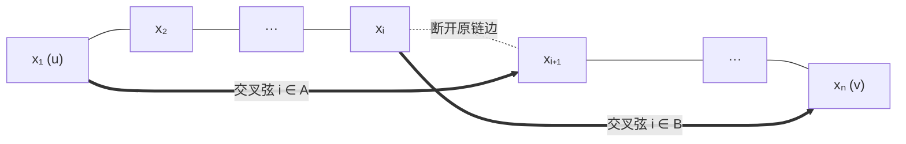
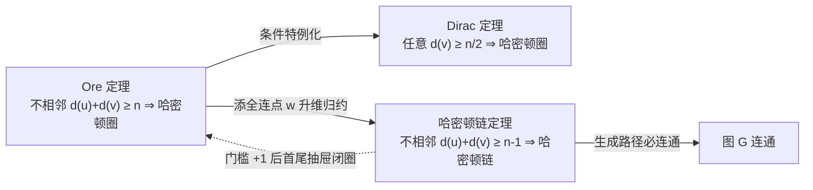

本文整理简单无向图 $G = (V, E)$（顶点数 $n = \vert V \vert$）中判定**哈密顿链**（遍历全部 $n$ 个顶点的基本通路）与**哈密顿圈**（遍历全部 $n$ 个顶点的简单圈，存在即称为哈密顿图）的三个经典度数充分条件。

---

## 一、结论先行：三个定理的内容

1. **Dirac 定理（最小度判哈密顿图，1952）**：设 $n \ge 3$，若对 $G$ 中**每个顶点**均有
   $$d(v) \ge \frac{n}{2} \qquad \left(\text{即 }\delta(G) \ge \frac{n}{2}\right)$$
   则 $G$ 是**哈密顿图**。

2. **Ore 定理（不相邻点度和判哈密顿图，1960）**：设 $n \ge 3$，若对 $G$ 中**任意一对不相邻顶点** $u, v$ 均有
   $$d(u) + d(v) \ge n$$
   则 $G$ 是**哈密顿图**。

3. **哈密顿链定理（不相邻点度和判哈密顿链）**：设 $n \ge 1$，若对 $G$ 中**任意一对不相邻顶点** $u, v$ 均有
   $$d(u) + d(v) \ge n - 1$$
   则 $G$ 中存在**哈密顿链**。（推论：若对任意顶点 $v$ 有 $d(v) \ge \frac{n-1}{2}$，则 $G$ 存在哈密顿链。）

| 定理 | 阶数要求 | 度数充分条件 | 结论 | 门槛减 $1$ 典型反例 |
|---|---|---|---|---|
| **Dirac 定理** | $n \ge 3$ | $\forall v,\ d(v) \ge \frac{n}{2}$ | 哈密顿圈 | 奇阶完全二部图 $K_{m, m+1}$ |
| **Ore 定理** | $n \ge 3$ | $u \nsim v \implies d(u)+d(v) \ge n$ | 哈密顿圈 | 蝴蝶图（两 $K_3$ 共用 $1$ 个割点） |
| **哈密顿链定理** | $n \ge 1$ | $u \nsim v \implies d(u)+d(v) \ge n - 1$ | 哈密顿链 | $K_{\lfloor n/2 \rfloor} \cup K_{\lceil n/2 \rceil}$（不连通） |

---

## 二、证明拆解（各保留最优证法）

以 **Ore 定理** 作为逻辑底座，即可无循环、零冗余地串联起全部证明：

### 1. Ore 定理（极大非哈密顿图 + 错位下标集反证法）

**思路拆解**：先不断加边构造“再加一边就成哈密顿图”的极大反例 $H$，删去新边白嫖一条哈密顿链；再通过**错位下标集**把端点邻边转化为“8 字交叉反接”构圈，最后用抽屉原理导出矛盾。

**证明**：反设满足条件的图 $G$（$n \ge 3$）不是哈密顿图。

1. **取极大非哈密顿图 $H$**：在 $G$ 上不断添边直到无法保持“非哈密顿”为止，得到超图 $H$。因 $K_n$（$n \ge 3$）必哈密顿，故 $H \neq K_n$，存在不相邻顶点 $u, v$；加边不减度数，故 $d_H(u) + d_H(v) \ge n$。又 $H + uv$ 必有哈密顿圈且必用边 $uv$，删去 $uv$ 即得 $H$ 中的一条哈密顿链：
   $$P = x_1 x_2 \cdots x_n \qquad (x_1 = u,\ x_n = v)$$

2. **定义错位下标集**：令
   $$A = \{i \in \{1, \dots, n-1\} \mid u x_{i+1} \in E(H)\}, \qquad B = \{i \in \{1, \dots, n-1\} \mid v x_i \in E(H)\}$$
   因 $u \nsim v$ 且图简单，$u, v$ 的全部邻点一一对应入 $\{1, \dots, n-1\}$，故 $\vert A \vert = d_H(u)$，$\vert B \vert = d_H(v)$。

3. **交叉构圈与抽屉原理矛盾**：若存在 $i \in A \cap B$，则 $x_1 x_{i+1} \in E(H)$ 且 $x_n x_i \in E(H)$，断开 $x_i x_{i+1}$ 并将后半段反接即可构成 $H$ 的哈密顿圈 $x_1 \cdots x_i x_n \cdots x_{i+1} x_1$，矛盾：

因此 $A \cap B = \varnothing$。由 $A \cup B \subseteq \{1, \dots, n-1\}$ 得
$$d_H(u) + d_H(v) = \vert A \vert + \vert B \vert = \vert A \cup B \vert \le n - 1$$
与 $d_H(u) + d_H(v) \ge n$ 矛盾，故 $G$ 必为哈密顿图。$\blacksquare$

### 2. Dirac 定理（一行归约至 Ore 定理）

**证明**：任取 $G$ 中不相邻顶点 $u, v$，由每个顶点度数 $\ge \frac{n}{2}$ 得 $d(u) + d(v) \ge \frac{n}{2} + \frac{n}{2} = n$，又 $n \ge 3$，直接由 **Ore 定理** 知 $G$ 是哈密顿图。$\blacksquare$

### 3. 哈密顿链定理（添全连点归约至 Ore 定理）

**思路拆解**：引入一个连向全图的辅助点 $w$，把 $n$ 阶图“找哈密顿链”转化为 $n+1$ 阶图“找哈密顿圈”。

**证明**：$n = 1$ 时单个顶点平凡成立；设 $n \ge 2$。在 $G$ 外添加顶点 $w$ 并与 $G$ 中所有顶点相连，得 $n+1$ 阶图 $G' = G \vee K_1$（$n+1 \ge 3$）。

因 $w$ 与其余所有点相邻，故 $G'$ 中任意不相邻顶点 $u, v$ 必属 $V(G)$ 且在 $G$ 中不相邻，二者在 $G'$ 中度数均 $+1$：
$$d_{G'}(u) + d_{G'}(v) = d_G(u) + d_G(v) + 2 \ge (n - 1) + 2 = n + 1 = \vert V(G') \vert$$
由 **Ore 定理**，$G'$ 存在哈密顿圈 $C$；从 $C$ 中删去 $w$ 及其两条关联边，余下路径即 $G$ 的一条哈密顿链。$\blacksquare$

> 若 $\forall v,\ d(v) \ge \frac{n-1}{2}$，则不相邻点满足 $d(u)+d(v) \ge n-1$，立即得推论成立。

---

## 三、三个定理的关联总结

1. **条件强弱与归约网络**：满足条件范围呈严格真包含 $\text{Dirac} \subsetneq \text{Ore} \subsetneq \text{哈密顿链}$。
   - **Ore 强于 Dirac**：$K_4$ 外加第 $5$ 个点连向其中两点，最小度 $2 < \frac{5}{2}$ 不满足 Dirac，但仅有的不相邻点对度和均为 $2 + 3 = 5$，满足 Ore。
   - **链弱于圈**：蝴蝶图（$n=5$）与 $K_{2,3}$ 满足哈密顿链定理，但不满足 Ore 定理且均无哈密顿圈。
2. **阈值相变（为什么链与圈刚好差 $1$）**：不相邻点度和 $\ge n-2$ 连连通性都不保证（如 $K_{\lfloor n/2 \rfloor} \cup K_{\lceil n/2 \rceil}$）；跨过 $n-1$ 同时保证**连通与哈密顿链**；再加 $1$ 到 $n$ 则在 $n-1$ 个间隔的抽屉中强制产生交叉弦，从而**闭合成圈**（也可从添点视角看：加 $1$ 个全连点阶数 $+1$、度和 $+2$，净差正好为 $1$）。
3. **共同本质与边界**：三者共享“错位下标集 + 抽屉原理”引擎，但**均只是充分非必要条件**（例如 $n \ge 5$ 的单纯圈 $C_n$ 不相邻点度和只有 $4$，却本身就是哈密顿图）；此外成圈定理必须要求 $n \ge 3$（排除 $K_2$）。
