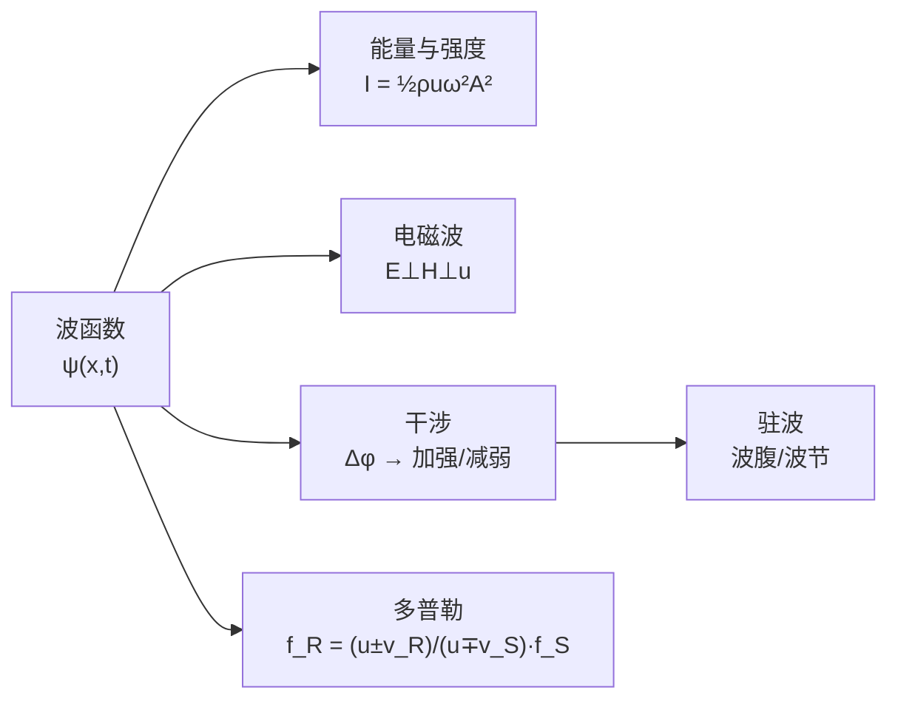

> 这一章公式不少，但主线只有一条：**振动 → 传播（波函数）→ 能量 → 叠加（干涉/驻波）→ 相对运动（多普勒）**。
> 本文只保留考试要用的公式、判断口诀和解题套路，概念推导全部略去。

---

## 一、波函数：一切的起点

### 1. 三个基本量（概念题常考）

$$u=\frac{\lambda}{T}=\nu\lambda,\qquad k=\frac{2\pi}{\lambda}=\frac{\omega}{u}$$

| 量 | 由谁决定 | 过界面时 |
| :-- | :-- | :-- |
| 频率 $\nu$ | **仅波源** | **不变** |
| 波速 $u$ | **仅介质** | 改变 |
| 波长 $\lambda=u/\nu$ | 二者共同 | 随 $u$ 改变 |

常见波速：弦 $u=\sqrt{T/\eta}$；固体棒纵波 $u=\sqrt{Y/\rho}$；气体 $u=\sqrt{\gamma RT/M}$。横波只能在固体中传播。

### 2. 平面简谐波

$$\boxed{\psi(x,t)=A\cos\!\Big[\omega\Big(t\mp\frac{x}{u}\Big)+\varphi_0\Big]=A\cos\!\Big[2\pi\Big(\frac{t}{T}\mp\frac{x}{\lambda}\Big)+\varphi_0\Big]}$$

- 沿 $+x$ 传播取 **减号**，沿 $-x$ 传播取 **加号**。
- 相位差：同一点不同时刻 $\Delta\Phi=\omega\Delta t$；同一时刻不同点 $\Delta\Phi=k\Delta x=2\pi\Delta x/\lambda$。
- 传播方向上，**下游质元相位落后**。

### 3. 质元速度怎么看（看图题秒杀）

沿 $+x$ 传播的波：

$$v=\frac{\partial\psi}{\partial t}=-u\frac{\partial\psi}{\partial x}$$

- 波形曲线上**斜率 < 0（下坡）→ 质元向上运动**；斜率 > 0（上坡）→ 向下运动。
- 等价做法：把波形沿传播方向平移一点点，看质元落到上方还是下方。

### 4. 求波函数「三步走」

1. **定三要素**：$A$（看图峰值）、$\lambda$（看图重复间距）、$T=\lambda/u$。
2. **定初相 $\varphi_0$**：选 $x=0$ 点，由 $t=0$ 时的位移和速度（速度方向由斜率判断），用旋转矢量法锁定 $\varphi_0\in(-\pi,\pi]$。
3. **写式并检验**：向右用 $(t-x/u)$，向左用 $(t+x/u)$；代入一个特殊点（如波峰）验证。

---

## 二、波动方程与能量

### 1. 波动方程

$$\frac{\partial^2\psi}{\partial x^2}=\frac{1}{u^2}\frac{\partial^2\psi}{\partial t^2}$$

任何形如 $f(t\mp x/u)$ 的函数都是解。球面波：$\psi=\dfrac{A}{r}\cos[\omega(t-r/u)+\varphi_0]$。

### 2. 能量：和单个谐振子完全不同

$$w_k=\frac12\rho\Big(\frac{\partial\psi}{\partial t}\Big)^2,\quad w_p=\frac12Y\Big(\frac{\partial\psi}{\partial x}\Big)^2,\quad \boxed{w_k=w_p}$$

- 行波中**动能、势能同相、处处相等**：质元过**平衡位置**时总能量**最大**，在**波峰/波谷**时能量为 **0**。
- 平均能量密度 $\overline w=\tfrac12\rho\omega^2A^2$。
- **波强**（平均能流密度）：

$$I=\overline w\,u=\frac12\rho u\,\omega^2A^2=\frac12 Z\omega^2A^2,\qquad Z=\rho u$$

### 3. 振幅随距离的衰减（能量守恒：$I\cdot S=\text{常数}$）

| 波型 | $I\propto$ | 振幅 $A\propto$ |
| :-- | :-- | :-- |
| 平面波 | 常数 | 常数 |
| 球面波 | $1/r^2$ | $1/r$ |
| 柱面波 | $1/r$ | $1/\sqrt r$ |

### 4. 声强级

$$L=10\lg\frac{I}{I_0}\ \text{(dB)},\qquad I_0=10^{-12}\ \text{W/m}^2$$

声强变为 10 倍，声强级加 10 dB。

---

## 三、惠更斯原理与电磁波

- **反射**：$i=i'$。**折射**：$\dfrac{\sin i}{\sin\gamma}=\dfrac{u_1}{u_2}=\dfrac{n_2}{n_1}$。
- **衍射**：缝宽 $d\lesssim\lambda$ 时明显。
- 电磁波速：$u=\dfrac{1}{\sqrt{\varepsilon\mu}}$，真空 $c=\dfrac{1}{\sqrt{\varepsilon_0\mu_0}}$；折射率 $n=c/u$，介质中 $\lambda=\lambda_0/n$（$\nu$ 不变）。

### 电磁波三大特点

1. **横波**：$\vec E\perp\vec H\perp\vec u$，且 $\vec u\parallel\vec E\times\vec H$。
2. $\vec E$ 与 $\vec H$ **同相位**。
3. 量值关系 $\sqrt\varepsilon E=\sqrt\mu H$，真空中 $E=cB$。

### 能流与光压

$$\vec S=\vec E\times\vec H,\qquad I=\overline S=\frac12E_0H_0=\frac{E_0^2}{2\mu_0c}=\frac12\varepsilon_0cE_0^2$$

- 电场能 = 磁场能，$w=\varepsilon E^2$。
- 光压：**全吸收** $p=\dfrac{I}{c}$，**全反射** $p=\dfrac{2I}{c}$。

### 解题思路

- **求场强振幅**：先由 $\overline S=P/A$ 求强度（点源 $A=4\pi R^2$；光束 $A=\pi d^2/4$），再 $E_0=\sqrt{2\mu_0c\,\overline S}$，$B_0=E_0/c$。
- 题干没给时间和面积时，“辐射能量”按**功率**算，“辐射压力”按**压强**算。
- 全部先化为 SI 单位。

---

## 四、波的干涉

### 1. 相干三条件

**频率相同、振动方向相同、相位差恒定。**

### 2. 核心公式

$$\boxed{\Delta\varphi=(\varphi_2-\varphi_1)-\frac{2\pi(r_2-r_1)}{\lambda}\ \big(+\text{半波损失 }\pi\big)}$$

$$A=\sqrt{A_1^2+A_2^2+2A_1A_2\cos\Delta\varphi},\qquad I=I_1+I_2+2\sqrt{I_1I_2}\cos\Delta\varphi$$

| 结果 | 相位差 | 同相波源的波程差 $\delta$ | 振幅 |
| :-- | :-- | :-- | :-- |
| **加强** | $2k\pi$ | $k\lambda$ | $A_1+A_2$ |
| **减弱** | $(2k+1)\pi$ | $(k+\tfrac12)\lambda$ | $\lvert A_1-A_2\rvert$ |

等强双波：$I=4I_0\cos^2(\Delta\varphi/2)$，$I_{\max}=4I_0$，$I_{\min}=0$。

### 3. 解题思路

- **共线双波源，求连线外侧**：外侧任一点的波程差恒等于波源间距 $d$，所以外侧各点强度处处相同。只需判断哪列波多走了 $d$（相位滞后 $2\pi d/\lambda$），代入 $\Delta\varphi$。
- **反射干涉（镜像法）**：作波源关于反射面的镜像点，反射波程 $r=\sqrt{d^2+4H^2}$。把“加强”和“相邻的首次相消”两个相位方程相减，半波损失和直达波项都消掉，得 $\Delta r=\lambda/2$。
- **多列波叠加**：先写每列波在 $P$ 点的分振动（相位滞后 $-2\pi r_i/\lambda$），再用旋转矢量法合成。初相为 $+\pi/2$ 与 $-\pi/2$ 的等幅矢量直接抵消。

---

## 五、驻波

### 1. 驻波函数

$$\boxed{\psi=2A\cos\!\Big(\frac{2\pi x}{\lambda}+\frac{\varphi_2-\varphi_1}{2}\Big)\cos\!\Big(\frac{2\pi t}{T}+\frac{\varphi_2+\varphi_1}{2}\Big)}$$

- **波腹**振幅 $2A$，**波节**振幅 0。
- 相邻波节（或相邻波腹）间距 $\dfrac{\lambda}{2}$；波节与相邻波腹间距 $\dfrac{\lambda}{4}$。
- **相位**：同一段（相邻两波节之间）**同相**；隔着波节的两段**反相**。
- **能量**：无净能流。平衡位置时能量全在波腹（动能），最大位移时全在波节（势能）。

### 2. 半波损失（反射面是波节还是波腹）

| 反射类型 | 条件 | 半波损失 | 界面处 |
| :-- | :-- | :-- | :-- |
| 波疏 → 波密（固定端） | $\rho_1u_1<\rho_2u_2$ | **有**（相位突变 $\pi$） | **波节** |
| 波密 → 波疏（自由端） | $\rho_1u_1>\rho_2u_2$ | **无** | **波腹** |

### 3. 简正模（先看两端是节还是腹）

| 边界 | 条件 | 频率 |
| :-- | :-- | :-- |
| 两端固定（两端波节） | $L=n\dfrac{\lambda}{2}$ | $\nu_n=\dfrac{nu}{2L}$，$n=1,2,\dots$ |
| 一端固定一端自由（节 + 腹） | $L=(2n+1)\dfrac{\lambda}{4}$ | $\nu_n=\dfrac{(2n+1)u}{4L}$，只有**奇次谐频** |

### 4. 解题思路

- **驻波拆成两列行波**：用积化和差展开，保持 $\omega t$ 项为正。
  - 空间项是 $\sin kx$ → 原点是波节，两列波在原点反相，**系数一正一负**。
  - 空间项是 $\cos kx$ → 原点是波腹，**系数同号**。
- **入射波 + 反射波全套**：
  1. 由 $t=0$ 时原点的位移和速度定 $\varphi_0$；
  2. 入射波：$t\to t-x/u$；
  3. 反射波分三步：先求入射波在反射面 $x_0$ 处的相位 → 按界面性质决定是否加 $\pi$ → 减去从 $x_0$ 传回 $x$ 的滞后 $\dfrac{2\pi}{\lambda}(x_0-x)$；
  4. 叠加得驻波；求区间内波节/波腹，令空间项等于 $0$ 或 $\pm1$，从通解里筛出落在区间内的值。
- **求某点合振动**：代入位置后若空间项是负号，用 $-\cos\theta=\cos(\theta\pm\pi)$ 把负号并入初相，**振幅必须取正**。

---

## 六、多普勒效应与拍

### 1. 机械波

$$\boxed{f_R=\frac{u\pm v_R}{u\mp v_S}\,f_S}$$

**口诀：相互靠近频率升，相互远离频率降。**

- 观察者 $R$ 靠近波源 → 分子 $+v_R$；远离 → $-v_R$。
- 波源 $S$ 靠近观察者 → 分母 $-v_S$；远离 → $+v_S$。
- 不确定时，先判断两者距离是缩小还是增大，再定符号，不要硬套坐标轴方向。
- 速度与连线成夹角时，只取沿连线方向的分量（乘 $\cos\theta$）。

### 2. 运动反射面（雷达、测速、彩超）

反射面有**双重身份**，分两步：

1. 先当**接收器**：$f'=\dfrac{u+v}{u}f_0$（反射面迎着波源运动）；
2. 再当**新波源**：$f''=\dfrac{u}{u-v}f'$。

合起来：$f''=\dfrac{u+v}{u-v}f_0$。

### 3. 拍

$$\Delta\nu=\lvert\nu_2-\nu_1\rvert$$

典型结论（$v\ll u$ 时）：

- 波源 $v_s$ 靠近静止反射面（远离静止的 $A$）：$\nu_1=\dfrac{u}{u+v_s}\nu$，$\nu_2=\dfrac{u}{u-v_s}\nu$，$\Delta\nu\approx\dfrac{2v_s}{u}\nu$。
- 波源和 $A$ 都静止，反射面以 $v$ 靠近：$\nu_1=\nu$，$\nu_2=\dfrac{u+v}{u-v}\nu$，$\Delta\nu\approx\dfrac{2v}{u}\nu$。

**周期性脉冲计数**（如警钟每隔 $T$ 响一次）：当成频率 $1/T$ 的波源，求出观察者的 $\nu'$，听到的次数 $N=\nu' t$，按实际情况取整。

### 4. 光的多普勒与冲击波

- 光的纵向多普勒（相对论）：$f_R=\sqrt{\dfrac{c+v}{c-v}}\,f_S$，接近时蓝移，退行时红移；横向 $f_R=\sqrt{1-v^2/c^2}\,f_S$。
- 马赫数 $M=\dfrac{v_S}{u}$（$>1$ 为超音速），马赫角 $\sin\theta=\dfrac{u}{v_S}=\dfrac1M$。

---

## 七、高频易错点

| 易错点 | 错误做法 | 正确做法 |
| :-- | :-- | :-- |
| 单位 | 直接代入 mm、mW、km/h | 统一成 SI（m、W、m/s） |
| 半波损失 | 漏加，或来回各加一次 | **只在波疏→波密反射的那一下加一次 $\pi$** |
| 合振动振幅 | 结果里留负号，如 $-\sqrt3A\cos\omega t$ | 负号并入相位 $\pm\pi$，振幅取正 |
| 多普勒符号 | 死记正方向 | 看距离是缩短还是增大 |
| 行波能量 | 套用谐振子“动势能反相” | 行波中动能 = 势能，平衡位置能量最大 |
| 波速/频率 | 认为过界面 $\nu$ 会变 | $\nu$ 不变，变的是 $u$ 和 $\lambda$ |

---

## 公式速记清单

| 主题 | 公式 |
| :-- | :-- |
| 波函数 | $\psi=A\cos[\omega(t\mp x/u)+\varphi_0]$ |
| 质元速度与斜率 | $v=-u\,\partial\psi/\partial x$（$+x$ 传播） |
| 波强 | $I=\tfrac12\rho u\omega^2A^2$ |
| 声强级 | $L=10\lg(I/I_0)$ |
| 电磁波强度 | $I=\tfrac12\varepsilon_0cE_0^2$，光压 $I/c$ 或 $2I/c$ |
| 相位差 | $\Delta\varphi=\Delta\varphi_0-2\pi\Delta r/\lambda$ |
| 干涉极值 | 加强 $2k\pi$，减弱 $(2k+1)\pi$ |
| 驻波 | $2A\cos(kx+\dots)\cos(\omega t+\dots)$，节间距 $\lambda/2$ |
| 两端固定弦 | $\nu_n=nu/2L$ |
| 一端固定一端自由 | $\nu_n=(2n+1)u/4L$ |
| 多普勒 | $f_R=\dfrac{u\pm v_R}{u\mp v_S}f_S$ |
| 马赫角 | $\sin\theta=u/v_S$ |

